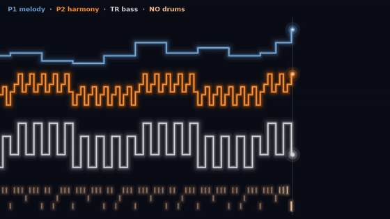
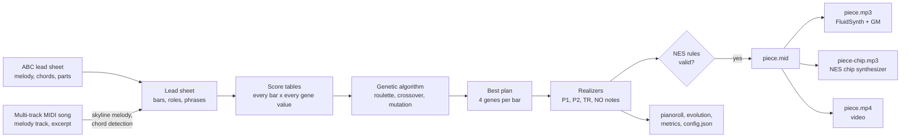
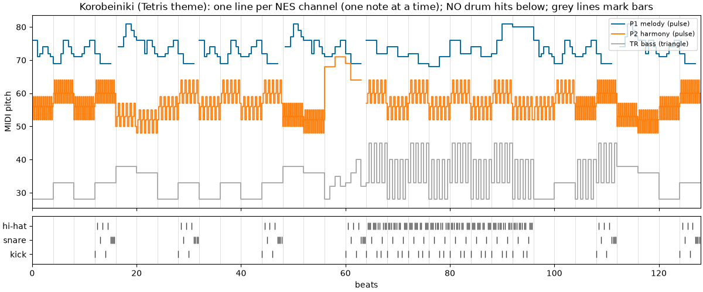

# TP1 – A Genetic Algorithm that Arranges Songs for the NES Sound Chip



*Korobeiniki, seed 1, in the bridge. The image shows a few seconds of the video: P1 is the melody
(blue), P2 the arpeggios (orange), TR the octave-pump bass (grey), and the bottom band holds the
drum hits of a sixteenth-note beat.*

DCC831 – Generative AI for Music (UFMG, 2026/2). Assignment 1: algorithmic composition.

> **Where this repository comes from.** The project started as the first assignment (TP1) of the
> course. The version submitted for grading stays in
> [GiowGiow/chiptune-ga-arranger](https://github.com/GiowGiow/chiptune-ga-arranger) (tag
> `v1.0-submission`). This repository continues the work after the submission: the browser
> arranger (spec 002), meters beyond 4/4 with allowed textures (spec 003) and any time signature
> (spec 006). It starts from one
> commit, so commit hashes cited in `specs/` refer to the original repository.

This project re-composes a song as 8-bit music. It reads a lead sheet (a melody with chord symbols
and part labels) and arranges it for the four voices of the Nintendo Entertainment System (NES)
sound chip. A **genetic algorithm** (GA) chooses, bar by bar, what each voice plays.

**Listen:** [giowgiow.github.io/nes-genetic-arranger/listen](https://giowgiow.github.io/nes-genetic-arranger/listen/)
has a player for the original, General MIDI and chip versions of every piece, and its video.

**Arrange your own song:** [giowgiow.github.io/nes-genetic-arranger/arranger](https://giowgiow.github.io/nes-genetic-arranger/arranger/)
runs the same genetic algorithm in your browser on an ABC or MIDI file of your choice (see
[Arrange your own song in the browser](#arrange-your-own-song-in-the-browser)).

## Method

**Stylistic constraint: the NES 2A03 four-voice idiom.** The chip has four channels, and each one
plays one note at a time:

| Channel | Wave | Role in the arrangement | Textures the GA can choose per bar |
|---|---|---|---|
| P1 | pulse (square) | melody, as written in the lead sheet | octave: as written, one up, one down |
| P2 | pulse (square) | harmony | hold, 16th arpeggio, 32nd arpeggio, echo of P1, chord tone below the melody |
| TR | triangle | bass | root, octave pump, root–fifth, walking line |
| NO | noise | percussion (kick, snare, hi-hat) | none, half time, eighth beat, sixteenth beat, fill |

Because each channel is monophonic, chords become arpeggios, and a bass line and a drum part must
be invented. That is why an 8-bit cover is a re-composition and not a copy. Every arrangement is
checked against these rules before export: one note at a time per channel, the channel pitch
ranges (pulse MIDI 33–108, triangle 21–108), chord tones on strong beats for P2 and TR, and
complete bars of each bar's meter.

**Meters.** The submitted samples are all in 4/4. Since spec 003
([specs/003-meters-and-textures/](specs/003-meters-and-textures/)), the arranger also reads and
arranges songs in other meters, and songs whose meter changes. Since spec 006
([specs/006-any-meter/](specs/006-any-meter/)) it accepts every time signature n/d with d = 1, 2,
4, 8 or 16 and n from 1 to 32 (3/2, 6/4, 5/8, 11/8, 12/16 and so on), the additive ABC meters
(`M:2+2+3/8`, `M:(3+3+2)/8`), `C` and `C|`. A meter outside that range, such as 3/32, 33/8 or
the free meter `M:none`, is refused with an error that names the bar and the accepted range.
Each bar carries its meter, and the textures follow its beats and strong beats, which one rule
derives from the meter (see "Meter terms" below):

- TR root–fifth plays the root on the strong beats and the fifth on the weak ones: root, fifth,
  root, fifth in 4/4, and "oom-pah-pah" in a waltz. The walking line plays one note per beat.
- NO puts the kick on strong beats and the snare on weak beats: kick on 1 and 3 and snare on 2
  and 4 in 4/4; kick on 1 and snare on 2 and 3 in 3/4; kick on the first eighth and snare on the
  fourth in 6/8. A fill rolls the snare on the bar's last beat.
- The fitness measures each bar on its own grid of sixteenth notes (12 in 3/4, 16 in 4/4).
- A MIDI song's chords are detected once per group of beats: half bars in 4/4 and 12/8, 3 + 2
  beats in 5/4, and the whole bar in 3/4 or 6/8.

In 4/4 every rule gives exactly the notes of the submitted version, so the samples do not
change.

**Allowed textures.** The setting `allowed` lists, for each gene, the values the GA may use. For
example, `--set 'allowed.p2=["hold","arp16","echo","third"]'` keeps the 32nd-note arpeggio out.
The 16th and 32nd arpeggios score the same on every criterion, so without this setting the GA
picks between them almost at random. The first population and mutation draw only allowed values.
With every value allowed, they draw the same random numbers as before the setting existed.

**Defaults since spec 004** ([specs/004-sound-packs-and-defaults/](specs/004-sound-packs-and-defaults/)):
fidelity weighs 1 like the other criteria, and the GA leaves out the 32nd-note arpeggio and the
held bass root. The samples were made before, with fidelity 0.5 and every value allowed; their
`config.json` records say so, so they still rerun to the same pieces.

**Genetic algorithm.**

- **Genotype:** 4 integer genes per bar (P2 texture, TR texture, NO pattern, P1 octave).
  Deterministic *realizers* turn each gene value into the notes of the bar, so every genotype is
  a valid arrangement.
- **Initial population:** random genotypes (60 by default).
- **Fitness:** a weighted mean of seven music-theory criteria, each from 0 to 1:
  - *complementarity*: P2 calm when the melody is busy, active when it rests;
  - *register*: P2 below P1;
  - *coherence*: the same textures inside a 4-bar phrase (a drum fill may close the phrase);
  - *contrast*: the chorus denser than the verse;
  - *bass smoothness*: small leaps along the bass line, inside bars and across bar lines (the
    upper notes of the octave pump are an ornament, not leaps);
  - *idiom*: arpeggios over bars with a single chord, drum fills exactly at phrase ends;
  - *fidelity*: the melody stays in its written octave.
- **Selection:** roulette wheel with windowing (fitness minus the generation's minimum), plus
  elitism (the 2 best plans survive unchanged).
- **Crossover:** one cut point, only between bars.
- **Mutation:** each gene changes with probability 0.01.
- **Stopping:** 4000 generations, or 300 generations without improvement (400 for the MIDI
  songs, which are longer).

All hyperparameters are in [configs/default.json](configs/default.json) and can be changed with
`--set`, for example `--set weights.contrast=3`. The design is in
[specs/001-ga-chiptune-arranger/](specs/001-ga-chiptune-arranger/).

**Hyperparameters and what the samples change.** Every run records its full configuration in the
`config.json` of its folder.

| Hyperparameter | Default | What it does | Samples that change it |
|---|---|---|---|
| `seed` (command line) | required | Starts the one random generator. The same seed and configuration give the same piece; another seed gives another plan. | `korobeiniki-s2` uses seed 2; all others seed 1 |
| `population_size` | 60 | Plans (genotypes) per generation. | none |
| `max_generations` | 4000 | Upper limit on the number of generations. | none |
| `stagnation_window` | 300 | Stop after this many generations without a better plan. | MIDI songs: 400 |
| `mutation_rate` | 0.01 | Chance that each gene of a child changes to another valid value (about one gene per child). | none |
| `elite_count` | 2 | Best plans copied unchanged into the next generation. | none |
| `phrase_length` | 4 | Bars per phrase; coherence and drum fills follow phrases. | none |
| `weights.<criterion>` | 1 (fidelity was 0.5 until spec 004) | Importance of each fitness criterion in the weighted mean; 0 removes it. | every sample used fidelity 0.5; `ievan-polkka-s1-fidelity0`: fidelity 0, so the GA is free to move the melody by an octave |
| `midi.melody_track` | none | MIDI songs only: the track (or tracks) read as the melody. | each MIDI song (the track that carries the lyrics, or the line that plays throughout) |
| `midi.bars` | whole file | MIDI songs only: the excerpt, first and last bar. | each MIDI song |
| `midi.sections` | one part | MIDI songs only: part labels by bar; a label with "Chorus" (or "B") gets the chorus role, which the contrast criterion uses. | each MIDI song |
| `midi.grid` | `auto` | MIDI songs only: use the file's beat grid, or re-estimate it from the drums when the file's tempo does not fit them. | none (Voa Voa is re-estimated automatically) |
| `allowed.<gene>` | every value but P2 `arp32` and TR `root` | The values the GA may draw for each gene (`p2`, `tr`, `no`, `p1_octave`). Added after the submission (spec 003); the default leaves out the 32nd-note arpeggio and the held bass root since spec 004. | every sample allowed every value (a record without `allowed` loads that way) |



## Layout

- `src/`: source code (entry point: `src/main.py`)
  - `leadsheet/`: ABC and MIDI reading, chord helpers
  - `arrangement/`: realizers, assembly, NES rule validation
  - `ga/`: genotype, operators, score tables, fitness, evolution loop
  - `analysis/`: objective metrics
  - `export/`: MIDI, audio (General MIDI and chip), figures, videos, run folders
- `data/leadsheets/`: the input lead sheets (two written by hand, six reduced from MIDI songs)
- `data/sources.json`: where each MIDI song comes from (URL, SHA-256, lead-sheet settings)
- `configs/default.json`: default hyperparameters
- `tests/`: tests (pytest); the docstring examples in `src/` also run as tests
- `samples/`: curated generated pieces (MIDI, MP3, piano roll, evolution, metrics, config, notes)
- `outputs/`: every generation run, one folder per run (not versioned)
- `listen/`: a static listening page (audio players and videos of every sample), served by GitHub
  Pages
- `arranger/`: the browser arranger, a static page that runs the method in the visitor's browser
  (JavaScript modules, tests in `arranger/tests/`, no build step)
- `src/catalog/`: the crawler that lists the MPB MIDI catalog for the browser arranger's search
- `paper/`: the ISMIR abstract (`tp1.tex`), with the official ISMIR 2026 template files from
  [ismir/paper_templates@2026v1](https://github.com/ismir/paper_templates/tree/2026v1/2026/latex)
- `specs/` and `.specify/`: [Spec Kit](https://github.com/github/spec-kit) design documents; the
  project rules are in `.specify/memory/constitution.md`

## Installation

The project uses [uv](https://docs.astral.sh/uv/) and Python 3.12.

```bash
uv sync
```

Without uv, use `requirements.txt`:

```bash
python3 -m venv .venv && source .venv/bin/activate && pip install -r requirements.txt
```

To render audio, install FluidSynth, a General MIDI soundfont and ffmpeg. On Debian/Ubuntu:

```bash
sudo apt install fluidsynth fluid-soundfont-gm ffmpeg
```

## Usage

Arrange an ABC lead sheet (the seed is required):

```bash
uv run src/main.py arrange data/leadsheets/korobeiniki.abc --seed 1
```

Arrange a multi-track MIDI song. The song is first reduced to a lead sheet:

- the melody comes from the chosen track or tracks;
- one chord is detected per half bar in 4/4 (per group of beats in other meters) from the other
  tracks;
- bar lines follow the file's time signatures, counting from its first bar;
- `midi.bars` picks an excerpt (by default, from the first to the last bar with a pitched note),
  and `midi.sections` marks where each part starts.

```bash
uv run src/main.py arrange data/raw/chiclete/voa_voa.mid --seed 1 \
    --set midi.melody_track=3 --set 'midi.bars=[8,56]' \
    --set 'midi.sections=[[0,"A"],[16,"Pre"],[32,"Chorus"]]'
```

MIDI files recorded live may not follow their own tempo. "Voa Voa" says 120 BPM but was played at
about 110 BPM. When the drum hits do not fit the file's grid, the reader estimates the real beat
grid from the drums (`midi.grid` is `"auto"` by default; `"file"` or `[bpm, downbeat_seconds]`
force a grid).

Each run writes `outputs/<input>-s<seed>-<config hash>/` with:

- `piece.mid`;
- `piece.mp3` (General MIDI timbres) and `piece-chip.mp3` (the project's NES chip synthesizer);
  `--renderer gm|chip|both` picks the renderers, and `both` is the default;
- `input.mid` and `input.mp3`: the input made audible for comparison;
- `pianoroll.png` and `pianoroll.pdf`;
- `evolution.csv`, `evolution.png` and `evolution.pdf`;
- `metrics.json`;
- `config.json`: the seed, every hyperparameter, the input hash, the git commit and the date.

Copy a run to the curated samples (and its vector figures to `paper/figures/`), and render its
"Bach Vision Test" style video (`piece.mp4`, with the chip audio):

```bash
uv run src/main.py sample outputs/<run-id> <sample-name>
uv run src/main.py video samples/<sample-name>
```

Run the tests:

```bash
uv run pytest
```

## Reproducing the results

Each sample was made by one `arrange` command and copied with `sample`. The same command
rebuilds the same notes. The run folder name ends with the hash of the configuration: `39aaf0de`
is the default configuration.

```bash
uv run src/main.py arrange data/leadsheets/ievan_polkka.abc --seed 1
uv run src/main.py sample outputs/ievan_polkka-s1-39aaf0de ievan-polkka-s1
```

```bash
uv run src/main.py arrange data/leadsheets/ievan_polkka.abc --seed 1 --set weights.fidelity=0
uv run src/main.py sample outputs/ievan_polkka-s1-5bf5c409 ievan-polkka-s1-fidelity0
```

```bash
uv run src/main.py arrange data/leadsheets/korobeiniki.abc --seed 1
uv run src/main.py sample outputs/korobeiniki-s1-39aaf0de korobeiniki-s1
```

```bash
uv run src/main.py arrange data/leadsheets/korobeiniki.abc --seed 2
uv run src/main.py sample outputs/korobeiniki-s2-39aaf0de korobeiniki-s2
```

The MIDI songs need their source files in `data/raw/`. This command downloads the five that are on
the web and checks each file against the SHA-256 hash recorded in
[`data/sources.json`](data/sources.json). It skips files already present, and it stops with an
error if a site now serves a different file. "Voa Voa" has no public download, so the command only
reports it.

```bash
uv run src/main.py fetch
```

Each command below sets the melody track, the bar excerpt and the sections. The longer songs use
up to 4000 generations with a stagnation window of 400:

```bash
G="--set max_generations=4000 --set stagnation_window=400"
uv run src/main.py arrange data/raw/chiclete/voa_voa.mid --seed 1 $G --set midi.melody_track=3 \
    --set 'midi.bars=[8,56]' --set 'midi.sections=[[0,"A"],[16,"Pre"],[32,"Chorus"]]'
uv run src/main.py arrange data/raw/mpb/mulher_de_fases.mid --seed 1 $G --set midi.melody_track=6 \
    --set 'midi.bars=[8,40]' --set 'midi.sections=[[0,"A"],[8,"Chorus"],[16,"A"],[24,"Chorus"]]'
uv run src/main.py arrange data/raw/mpb/amor_i_love_you.mid --seed 1 $G --set midi.melody_track=2 \
    --set 'midi.bars=[0,56]' --set 'midi.sections=[[0,"A"],[16,"B"],[24,"A"],[40,"Chorus"]]'
uv run src/main.py arrange data/raw/mpb/por_voce_bk.mid --seed 1 $G --set midi.melody_track=4 \
    --set 'midi.bars=[4,48]' --set 'midi.sections=[[0,"A"],[20,"Pre"],[28,"Chorus"]]'
uv run src/main.py arrange data/raw/mpb/aquarela.mid --seed 1 $G --set midi.melody_track=3 \
    --set 'midi.bars=[4,36]' --set 'midi.sections=[[0,"A"],[16,"B"]]'
uv run src/main.py arrange data/raw/mpb/fico_assim_sem_voce.mid --seed 1 $G --set midi.melody_track=1 \
    --set 'midi.bars=[10,58]' --set 'midi.sections=[[0,"A"],[16,"A"],[32,"Chorus"]]'
```

Then copy each run to `samples/` with the names used below, for example
`uv run src/main.py sample outputs/voa_voa-s1-ccca2416 voa-voa-s1`. The run folders are:

- `voa_voa-s1-ccca2416`
- `mulher_de_fases-s1-7de7248c`
- `amor_i_love_you-s1-e24d1066`
- `por_voce_bk-s1-c9ff249f`
- `aquarela-s1-d9735b16`
- `fico_assim_sem_voce-s1-d4fbaf8e`

Videos: `uv run src/main.py video samples/<sample-name>` for each sample.

Comparison videos (the three versions one after the other, at most 9.5 MB so that GitHub plays
them inline in this README): `uv run src/main.py compare samples/<sample-name>`, written to
`outputs/compare/`. Two titles need their accents: `--title "Por Você (s1)"` and
`--title "Fico Assim Sem Você (s1)"`.

**Without the MIDI files.** The committed ABC lead sheets hold the same lead sheets (the tests check
it for every song), so a fresh clone can rerun every MIDI sample from them, Voa Voa included:

```bash
G="--set max_generations=4000 --set stagnation_window=400"
uv run src/main.py arrange data/leadsheets/voa_voa.abc --seed 1 $G
uv run src/main.py arrange data/leadsheets/mulher_de_fases.abc --seed 1 $G
uv run src/main.py arrange data/leadsheets/amor_i_love_you.abc --seed 1 $G
uv run src/main.py arrange data/leadsheets/por_voce.abc --seed 1 $G
uv run src/main.py arrange data/leadsheets/fico_assim_sem_voce.abc --seed 1 $G
uv run src/main.py arrange data/leadsheets/aquarela.abc --seed 1 $G
```

These runs reach the same best fitness, in the same number of generations, with the same
arrangement as the samples. Three things differ:

- the run folder name, because the `midi` settings are no longer part of the configuration;
- `input.mp3`, which plays the plain lead sheet instead of the original MIDI excerpt;
- for the four songs whose tempo has more than six decimals (Voa Voa, Mulher de Fases, Amor I Love
  You, Fico Assim Sem Você), the ABC `Q:` field keeps six decimals, so 4 to 13% of the note events
  in `piece.mid` land one MIDI tick (about 2 ms) away.

The ABC lead sheets are rebuilt from the MIDI files with the settings recorded in each sample:

```bash
uv run src/main.py abc --all                 # every song of data/sources.json
uv run src/main.py abc samples/aquarela-s1   # one song
```

The experiments of the abstract compare 5 seeds, a random-search baseline and an ablation that
sets each criterion weight to 0. Each command writes `outputs/experiment-<song>-s1-<hash>/`
with `results.csv`, `results.md` and `seeds.pdf`:

```bash
uv run src/main.py experiment data/leadsheets/ievan_polkka.abc --seed 1
uv run src/main.py experiment data/leadsheets/korobeiniki.abc --seed 1
```

## Generated pieces

The [listening page](https://giowgiow.github.io/nes-genetic-arranger/listen/) plays every version in the
browser. Each song below starts with a short video that plays its three renderings one after the other:
the original input, the generated arrangement with General MIDI timbres, and the same arrangement
on the NES chip synthesizer (made with `uv run src/main.py compare`). Then come links to each
file, the full video, and the folder with every other file:

- `piece.mid`;
- the piano roll;
- the evolution log and figure;
- `metrics.json` and `config.json`;
- the listening notes, `notes.md`.

For an ABC tune, the original is the lead sheet played plainly (piano melody, block chords,
bass). For a MIDI song, the original is the fan-made MIDI file itself, rendered with the same
soundfont and cut to the same bars.

### Ievan Polkka

https://github.com/user-attachments/assets/1bcc5ea1-15a6-4010-942c-a4717456c6fa

| Original | Generated (General MIDI) | Generated (chip) | Video |
|---|---|---|---|
| [input.mp3](samples/ievan-polkka-s1/input.mp3) | [piece.mp3](samples/ievan-polkka-s1/piece.mp3) | [piece-chip.mp3](samples/ievan-polkka-s1/piece-chip.mp3) | [piece.mp4](samples/ievan-polkka-s1/piece.mp4) |

Input: ABC lead sheet (Loituma melody). Settings: default configuration, seed 1. Best fitness 0.912. Files and notes: [ievan-polkka-s1](samples/ievan-polkka-s1/).

### Ievan Polkka, fidelity weight 0

https://github.com/user-attachments/assets/3040602b-b0d7-4854-bdf3-4899ddd037b5

| Original | Generated (General MIDI) | Generated (chip) | Video |
|---|---|---|---|
| [input.mp3](samples/ievan-polkka-s1-fidelity0/input.mp3) | [piece.mp3](samples/ievan-polkka-s1-fidelity0/piece.mp3) | [piece-chip.mp3](samples/ievan-polkka-s1-fidelity0/piece-chip.mp3) | [piece.mp4](samples/ievan-polkka-s1-fidelity0/piece.mp4) |

Input: same lead sheet. Settings: seed 1 and `weights.fidelity=0` (default 0.5), so nothing keeps the melody in its written octave: the GA raises 12 of the 24 melody bars by an octave to win the register criterion. Best fitness 0.903*. Files and notes: [ievan-polkka-s1-fidelity0](samples/ievan-polkka-s1-fidelity0/).

### Korobeiniki (Tetris theme)

https://github.com/user-attachments/assets/19047f8a-f8c0-43a9-bcdc-cfd4d4a1620e

| Original | Generated (General MIDI) | Generated (chip) | Video |
|---|---|---|---|
| [input.mp3](samples/korobeiniki-s1/input.mp3) | [piece.mp3](samples/korobeiniki-s1/piece.mp3) | [piece-chip.mp3](samples/korobeiniki-s1/piece-chip.mp3) | [piece.mp4](samples/korobeiniki-s1/piece.mp4) |

Input: ABC lead sheet. Settings: default configuration, seed 1. Best fitness 0.922. Files and notes: [korobeiniki-s1](samples/korobeiniki-s1/).

### Korobeiniki, seed 2

https://github.com/user-attachments/assets/87a10aad-2767-44e1-b5ec-31acbe1dccbd

| Original | Generated (General MIDI) | Generated (chip) | Video |
|---|---|---|---|
| [input.mp3](samples/korobeiniki-s2/input.mp3) | [piece.mp3](samples/korobeiniki-s2/piece.mp3) | [piece-chip.mp3](samples/korobeiniki-s2/piece-chip.mp3) | [piece.mp4](samples/korobeiniki-s2/piece.mp4) |

Input: same lead sheet. Settings: default configuration, seed 2 (only the random generator changes). Best fitness 0.936. Files and notes: [korobeiniki-s2](samples/korobeiniki-s2/).

### Voa Voa (Chiclete com Banana)

https://github.com/user-attachments/assets/544a20bb-52da-4fce-b5d9-ef037b895f44

| Original | Generated (General MIDI) | Generated (chip) | Video |
|---|---|---|---|
| [input.mp3](samples/voa-voa-s1/input.mp3) | [piece.mp3](samples/voa-voa-s1/piece.mp3) | [piece-chip.mp3](samples/voa-voa-s1/piece-chip.mp3) | [piece.mp4](samples/voa-voa-s1/piece.mp4) |

Input: MIDI excerpt, bars 8–56 (`midi.bars`), melody on track 3, tenor sax (`midi.melody_track`), parts A / Pre / Chorus (`midi.sections`); beat grid re-estimated from the drums at 110 BPM. Settings: seed 1, up to 4000 generations, stagnation window 400. Best fitness 0.839. Files and notes: [voa-voa-s1](samples/voa-voa-s1/).

### Mulher de Fases (Raimundos)

https://github.com/user-attachments/assets/846a55d8-3812-44e0-a282-e1326fb780fe

| Original | Generated (General MIDI) | Generated (chip) | Video |
|---|---|---|---|
| [input.mp3](samples/mulher-de-fases-s1/input.mp3) | [piece.mp3](samples/mulher-de-fases-s1/piece.mp3) | [piece-chip.mp3](samples/mulher-de-fases-s1/piece-chip.mp3) | [piece.mp4](samples/mulher-de-fases-s1/piece.mp4) |

Input: MIDI excerpt, bars 8–40 (`midi.bars`), melody on track 6, harmonica (`midi.melody_track`), parts A / Chorus (`midi.sections`). Settings: seed 1, up to 4000 generations, stagnation window 400. Best fitness 0.896. Files and notes: [mulher-de-fases-s1](samples/mulher-de-fases-s1/).

### Amor I Love You (Marisa Monte)

https://github.com/user-attachments/assets/fceabcf5-b68e-43fa-9865-6a279dc99da8

| Original | Generated (General MIDI) | Generated (chip) | Video |
|---|---|---|---|
| [input.mp3](samples/amor-i-love-you-s1/input.mp3) | [piece.mp3](samples/amor-i-love-you-s1/piece.mp3) | [piece-chip.mp3](samples/amor-i-love-you-s1/piece-chip.mp3) | [piece.mp4](samples/amor-i-love-you-s1/piece.mp4) |

Input: MIDI excerpt, bars 0–56 (`midi.bars`), melody on track 2, flute (`midi.melody_track`), parts A / B / Chorus (`midi.sections`). Settings: seed 1, up to 4000 generations, stagnation window 400. Best fitness 0.833. Files and notes: [amor-i-love-you-s1](samples/amor-i-love-you-s1/).

### Por Você (Barão Vermelho)

https://github.com/user-attachments/assets/f381addc-173f-45d8-94f4-ef6fa1597b07

| Original | Generated (General MIDI) | Generated (chip) | Video |
|---|---|---|---|
| [input.mp3](samples/por-voce-s1/input.mp3) | [piece.mp3](samples/por-voce-s1/piece.mp3) | [piece-chip.mp3](samples/por-voce-s1/piece-chip.mp3) | [piece.mp4](samples/por-voce-s1/piece.mp4) |

Input: MIDI excerpt, bars 4–48 (`midi.bars`), melody on track 4, flute (`midi.melody_track`), parts A / Pre / Chorus (`midi.sections`). Settings: seed 1, up to 4000 generations, stagnation window 400. Best fitness 0.896. Files and notes: [por-voce-s1](samples/por-voce-s1/).

### Aquarela (Toquinho)

https://github.com/user-attachments/assets/1eca7356-e7d2-4cbd-bf85-d0adb6c6c067

| Original | Generated (General MIDI) | Generated (chip) | Video |
|---|---|---|---|
| [input.mp3](samples/aquarela-s1/input.mp3) | [piece.mp3](samples/aquarela-s1/piece.mp3) | [piece-chip.mp3](samples/aquarela-s1/piece-chip.mp3) | [piece.mp4](samples/aquarela-s1/piece.mp4) |

Input: MIDI excerpt, bars 4–36 (`midi.bars`), melody on track 3, clarinet (`midi.melody_track`), parts A / B (`midi.sections`). Settings: seed 1, up to 4000 generations, stagnation window 400. Best fitness 0.871. Files and notes: [aquarela-s1](samples/aquarela-s1/).

### Fico Assim Sem Você (Adriana Calcanhotto)

https://github.com/user-attachments/assets/caea6a4b-3200-4e8b-8829-0c0d47537097

| Original | Generated (General MIDI) | Generated (chip) | Video |
|---|---|---|---|
| [input.mp3](samples/fico-assim-sem-voce-s1/input.mp3) | [piece.mp3](samples/fico-assim-sem-voce-s1/piece.mp3) | [piece-chip.mp3](samples/fico-assim-sem-voce-s1/piece-chip.mp3) | [piece.mp4](samples/fico-assim-sem-voce-s1/piece.mp4) |

Input: MIDI excerpt, bars 10–58 (`midi.bars`), melody on track 1, flute (`midi.melody_track`), parts A / Chorus (`midi.sections`). Settings: seed 1, up to 4000 generations, stagnation window 400. Best fitness 0.872. Files and notes: [fico-assim-sem-voce-s1](samples/fico-assim-sem-voce-s1/).

\* The fidelity-0 run is scored without the fidelity criterion, so its fitness is not comparable
with the others.

How to read the results:

- **Stopping:** every run stopped after its stagnation window (300 generations for the ABC
  tunes, 400 for the MIDI songs).
- **The MIDI songs score lower** (0.83–0.90 against 0.91–0.94) for two reasons:
  - Their melodies often sit in octave 3 or 4. That pits the register criterion against fidelity.
  - They are longer, and their chords are detected automatically.

Piano rolls of two arrangements (every sample folder has its own `pianoroll.png`):

| Korobeiniki, seed 1 | Voa Voa, seed 1 |
|---|---|
|  |  |

## Arrange your own song in the browser

The [arranger page](https://giowgiow.github.io/nes-genetic-arranger/arranger/) (spec
`specs/002-browser-arranger/`) brings the method to any song:

1. Drop an ABC lead sheet or a multi-track MIDI file, or pick a song of the shelf.
   For a MIDI song, choose the melody track (the likeliest one is preselected), the bars to
   arrange and where each part starts. The page shows the lead sheet it read before any run,
   with its meter. Songs in any meter n/d (d = 1, 2, 4, 8 or 16, n from 1 to 32), and in additive
   ABC meters such as 2+2+3/8, are arranged.
2. Change any setting of `configs/default.json`; each one says what it changes in the music.
   "Allowed textures" keeps any texture out of the arrangement, for example the fast 32nd-note
   arpeggio.
3. Press Arrange. The GA runs in a background thread (a Web Worker) and the page draws its
   evolution live: the best and mean fitness, the generation and stagnation counters, and the
   best plan of four genes per bar. The "watch" pace runs about 400 generations per second so the
   evolution can be followed; "full speed" finishes in under a second.
4. Play the arrangement with the NES chip sound (softened: a rounder harmony pulse and a small
   TV speaker's filter; "NES chip (raw)" keeps the thin original), or switch the sound pack (Mega
   Drive FM synthesis, Super Nintendo samples with echo, Game Boy, Commodore 64, a soft synth or
   the original's plain instruments) without losing the position; switch to
   the original at the same position. Four small sliders set the level of P1, P2, bass and drums for the sound pack in
   use (each pack has its own defaults and your mix is remembered per pack), and the
   downloads are the MIDI, an audio WAV that follows the pack and the mix, the run's
   `config.json` and the lead sheet as ABC.

Files never leave the device: the page fetches only its own files. After the first visit it
works offline (a service worker caches it).

**Same algorithm, own random numbers.** The browser code is a module-by-module JavaScript port of
`src/`. It uses its own seeded generator (sfc32) instead of numpy's, so a seed reproduces the
same arrangement in any browser, but the same seed in the command line gives a different,
equally valid arrangement. Tests compare the port with this Python code on everything that does
not draw random numbers: the 8 lead sheets read from ABC, the 6 MIDI songs reduced to lead
sheets, the score tables, and the fitness of the 10 samples' plans (equal to 2·10⁻¹⁶). The
downloaded `config.json` reruns in the command line:

```bash
uv run src/main.py arrange song.mid --config song-s1-1234abcd.config.json --seed 1
```

**Song catalog.** The Song tab is a shelf of vinyl records (a page of 9, or 15 on a wide screen), with the list of
every song beside them and a search box above that list (click a title to select it,
double-click to arrange it; a file you open gets its own record at the top): the 8 examples first, then
every other song in alphabetical order. The run controls (seed, pace, Arrange, Settings) sit in
the same card, under the shelf, and on top of the Evolution tab, which also holds the result: change
a setting, press Arrange again and hear the new arrangement on the same screen. A run goes on
when you leave the tab. Search finds a song by title, composer or
performer, and also looks for folk tunes on The Session. "Open MIDI or ABC" loads your own file.
Every catalog song opens like an example: one click, no track to choose.

- **Songs committed as ABC lead sheets** open straight from the repository: public-domain songs (every author
  died 70 or more years ago, checked on Wikidata; an unknown author counts as not public domain),
  the best-known tunes of the cleaned Nottingham collection (19, GPL-3.0) and the 217 most viewed
  PDMX scores by public-domain composers (CC-BY 4.0). Obscure collection tunes are left out on
  purpose: a shelf of thousands of unknown titles is not worth browsing.
  `data/catalog/abc/` holds them, each collection with its license or notice file.
- **Copyrighted songs** (the MPB catalog of [Beatriz Kauffmann's Web Site](https://www.beakauffmann.com/),
  "All Rights Reserved") are not copied anywhere. The repository holds only facts about each song
  (title, composer, melody track, bars, key, tempo, meter, a hash of the file; no notes) and the
  address of its MIDI file. When you choose one, the page downloads the MIDI file from the site
  and tells you to drop it in: a page cannot read another site's file, and the file never passes
  through this project.
- **Search on The Session** goes from your browser to the site directly, at your request.

**The app is only the static page.** An earlier plan (spec 005) had a companion song server that
fetched MPB songs and searched Mutopia, BitMidi and IMSLP. It was withdrawn on 2026-10-21; the git
history keeps its code. Nothing else runs besides the files on GitHub Pages.

Rebuild the catalog data (needs the local MIDI study copy for the MPB analysis; PDMX and
Nottingham download into `data/raw/`, which is gitignored):

```bash
uv run src/main.py catalog analyze --dataset path/to/beakauffmann --workers 8
uv run src/main.py catalog authors
uv run src/main.py catalog public-domain --dataset path/to/beakauffmann --workers 8
uv run src/main.py catalog nottingham --workers 8
uv run src/main.py catalog pdmx --workers 8
uv run src/main.py catalog examples
uv run src/main.py catalog popularity
```

**Popularity.** Every catalog entry carries `pop`, a non-negative integer (higher is better
known), and the shelf lists the most popular songs first. `catalog popularity` adds it, as the
last step (the other commands write entries without it), and it also gives each MPB entry the
route `{"download": <MIDI link>}`. The numbers come from:

- **MPB and public-domain songs**: the Wikipedia page views of the last 12 full months of the
  song's article, summed over the Portuguese and English Wikipedias (Wikimedia pageviews API).
  The article is found on Wikidata and accepted only when the normalized title equals the label
  of a musical work (not an album) **and** a name of the entry's composers or performer is among
  the work's composers, lyricists or performers (the surname, or the whole name for a very common
  surname like Silva). A song without a safe match takes a twentieth of the page views of its
  best-known artist (a composer or the performer, matched by exact name on Wikidata), so a song by
  a famous artist still outranks an obscure one but ranks below a matched famous song.
- **PDMX scores**: `(views + 20 * favorites + 50 * ratings * rating / 5) / 5` from `PDMX.csv`
  (its counters are all-time, so the division by 5 brings them near a yearly count).
- **Nottingham tunes**: 20,000 for the well-known tunes, 1 for the others. **Examples**: above
  everything else, in their curated order.

Wikidata is queried at least one second apart and the pageviews API at most five times a second,
with the project's User-Agent; every answer is cached under `data/raw/popularity/` (gitignored),
so a rerun needs no network. Only the resulting numbers are committed.

**Develop and test.** Serve the repository root and open `/arranger/`; run the JavaScript tests
with Node 22 (no install); regenerate the Python reference values they compare with:

```bash
python3 -m http.server 8765 --bind 127.0.0.1
```

```bash
cd arranger && node --test
```

```bash
uv run src/main.py fixtures
```

Terms used here: a *seeded generator* gives the same random numbers for the same seed; a *Web
Worker* runs code beside the page so the page stays responsive; the *skyline* of a MIDI track is
its highest note at each moment, which turns chords into a melody line; the *beat grid* places
the beats of a MIDI recording; *A/B* is switching between two versions at the same position.

Meter terms (specs 003 and 006):
- A *meter* (time signature) n/d gives the length of a bar, n notes of the value d (4 is a
  quarter note, 8 an eighth), and its beats: 3/4 has three quarter-note beats.
- A *compound meter* has a numerator that is a multiple of 3 from 6 on (6/8, 9/8, 12/8, 6/4). It
  groups its notes in threes, so its beat is a dotted note: 6/8 has two beats of a dotted quarter.
- An *irregular fast meter* has eighths or sixteenths, five notes or more and is not compound
  (5/8, 7/8, 8/8, 11/8). It groups its notes in twos, with a last group of three when n is odd:
  7/8 is felt 2 + 2 + 3, and 11/8 is felt 2 + 2 + 2 + 2 + 3.
- A *simple meter* is any other (2/2, 3/4, 4/4, 5/4, 7/4, 3/2, 3/8): each of its n notes is a
  beat. 5/4 is felt 3 + 2 because of its strong beats, not because of its beats.
- An *additive meter* (`2+2+3/8`) writes its own groups: each group is one beat, so a tune can
  ask for a grouping other than the rule's.
- The *beat grouping* is how the beats gather; its first beats are the *strong beats*: beat 1,
  and the first beat of the second half of the bar when the bar has four beats or more (the first
  half is the longer one when the number of beats is odd). So the strong beats are 1 and 3 in 4/4,
  only 1 in 3/4 or 6/8, 1 and 4 in 5/4 and in 11/8.
- A MIDI file's *time-signature map* lists where each meter starts. A MIDI time signature holds
  only n and d, so an additive meter is written there as its sum (7/8 for 2+2+3/8).
- *Allowed values* are the gene values (textures, drum patterns, octaves) that the GA may draw.

## Your own MIDI collections

A *collection* is one playlist of the song shelf: a tile with a cover, a name and its songs.
The app reads the list of collections from `arranger/data/catalog/collections.json` (the
*registry*), so a collection is added, hidden, renamed or moved with a command and no code
change. There are three kinds:

- `abc`: lead sheets committed to the repository (the Examples, public-domain songs, folk tunes
  and classical subset);
- `local-midi`: MIDI files committed to a folder of the repository, which the page fetches from
  its own site (the collections you make below);
- `remote`: songs that live on another site and open by download (MPB), so the repository holds
  only titles and links.

### Put your MIDI files in a collection: three steps

Only files you are allowed to redistribute belong here, because GitHub Pages publishes the whole
repository: your own work, a public-domain composition **whose MIDI sequence is also yours or
licensed to you**, or files under a license that allows redistribution. A public-domain
composition is not enough: someone made the MIDI sequence, and that person's sequence has its own
copyright, so check the license of the file you downloaded.

1. Put the files in a folder of the repository, for example `songs/baroque/` (sub-folders are
   fine, and a sub-folder is the album of its songs).
2. Run one command with the license of the folder (and, for a license that asks for credit, where
   the files come from):

   ```bash
   uv run src/main.py collection build songs/baroque --license CC0-1.0
   uv run src/main.py collection build songs/baroque --license CC-BY-4.0 --source "https://example.org/the-pianist"
   ```

3. Commit the MIDI files, `collection.toml` (if you made one) and `arranger/data/catalog/`, and
   push. The playlist appears in the app after the next deploy.

`build` finds everything else by itself, for each file:

| What | Where it comes from |
| --- | --- |
| Title and composer | the file name (`Composer - Title`, `Title - Composer`, `title_by_composer`, underscores and dashes as spaces, `Op.` or `BWV` numbers kept in the title) and the MIDI file's own text (sequence name, `Composer: ...`, `Title: ...`), then confirmed and normalized on [MusicBrainz](https://musicbrainz.org) (a work search: `Bach` becomes `Johann Sebastian Bach`) |
| Is the composition public domain? | the composer's death year on Wikidata (every composer died in 1955 or earlier: Lei 9.610/98, art. 41), as in `data/catalog/authors.json` |
| Popularity | Wikipedia page views of the work, else the composer's page views divided by 20 (the same rule as the other collections) |
| Album | the sub-folder, else the composer, so a folder of classical pieces groups by composer |
| Melody track, bars, key, tempo, meter, drums | measured on the file, as for the MPB catalog |
| Order | by popularity, best known first (`default_sort`) |

Lookups wait at least one second between requests, carry the project's User-Agent, and cache
every answer under `data/raw/` (gitignored), so a rerun needs no network. `--offline` uses the
cache only. Tests use fake lookups.

**Check before you publish.** `preview` prints the playlist as the app will show it, with where
each title and composer came from and the low-confidence matches marked, and writes nothing:

```bash
uv run src/main.py collection preview songs/baroque --license CC0-1.0
```

**Fix what is wrong, only if something is.** `init` writes `songs/baroque/collection.toml` with
everything it found, so a wrong match can be fixed in one place. The file is optional; a value in
it wins over a lookup, and a file added to the folder later needs no entry (`init` again appends
only the new files and never rewrites your edits):

```bash
uv run src/main.py collection init songs/baroque --license CC0-1.0
```

```toml
id = "baroque"                 # the collection's id (a slug) and catalog file name
name = "Baroque"               # the playlist's name in the app
description = ""
order = 100                    # place among the playlists; the built-in ones are 10 to 50
default_sort = "popularity"    # "popularity", "title" or "order" (the order numbers below)
license = "CC0-1.0"            # one license for the folder
source = ""                    # a link or a name; required by CC-BY style licenses

[[song]]
file = "Bach - Air on the G String.mid"
title = "Air on the G String"
composer = "Johann Sebastian Bach"
# found: title from file name; composer from MusicBrainz (high)
# composition public domain: yes (Johann Sebastian Bach, died 1750)
# Optional overrides (uncomment to use): performer, license, source, album, popularity, order,
# melody_track, bars = [first, end], public_domain = true, skip = true
```

**Licenses.** One license applies to the whole folder; a file may override it in the sidecar.
`build` refuses, and writes nothing, when a file has no license or one that does not allow
redistribution, and it lists the files:

| License | Accepted | Needs `--source` |
| --- | --- | --- |
| `public-domain`, `CC0-1.0`, `own-work` | yes | no |
| `CC-BY-<version>`, `CC-BY-SA-<version>` (for example `CC-BY-4.0`) | yes | yes (credit) |
| `GPL`, `LGPL`, `AGPL`, `MIT`, `Apache-2.0`, `BSD`, `ISC`, `Unlicense` | yes | yes, except `Unlicense` |
| anything with NonCommercial or NoDerivatives (`CC-BY-NC-4.0`, `CC-BY-ND-4.0`), "all rights reserved", empty | no | |

**The public-domain license is checked.** `public-domain` claims that the composition is free, so
a song whose composer Wikidata does not confirm as dead in 1955 or earlier (alive, unknown, or only
a surname) is left out and marked `NOT INCLUDED` in the preview. Pass `--include-unconfirmed` to
keep such songs, or write `public_domain = true` on one file in `collection.toml` when you know it
is free. When two people share a composer's name and all of them died long ago, the composition
counts as free. The other licenses cover the MIDI sequence and are not checked against the
composer, but the preview still reports each composition's status.

**In the app.** The collection is a tile named by `name`, placed by `order`, with the sprite of its
most popular song as cover. Its songs follow `default_sort`; when songs have albums, the tile opens
into one tile per album, like MPB's artists. Its songs open in one click, can enter Popular by their
popularity, show their license (and credit) in small muted type, and the visitor can download the
MIDI file, which is redistributable by your choice.

### Manage every collection

The `collection` command manages all the collections, the built-in ones included. Run from the
repository root; `--root` points at another folder (the tests use it).

| Command | What it does |
| --- | --- |
| `collection list` | table: id, name, kind, songs, enabled, order, size of its JSON, lazy |
| `collection show <id>` | the record, the catalog's envelope, its first songs, counts by license and route |
| `collection enable <id>` / `disable <id>` | a disabled collection is not loaded and has no tile; its file stays |
| `collection rename <id> "<name>"` | the playlist's name |
| `collection order <id> <n>` / `move <id> --before <other>` | the place among the playlists (`move` renumbers to 10, 20, 30...) |
| `collection lazy <id> on` / `off` | read the file only when the visitor opens its playlist or searches (MPB's 2 MB file is lazy) |
| `collection rebuild <id>` | run the command recorded in `generated`; `--dataset <MPB study copy>` for `mpb` and `public-domain`; refuses with the reason when the data it needs is missing |
| `collection add-remote <id> --name "..." --from songs.csv` | a new `remote` collection from a CSV or JSON list with `title`, `url` and optionally `composer`, `performer`, `popularity`, `license`; no file is fetched, each song opens by download from its site |
| `collection remove <id>` | unregister and delete the catalog file, never your MIDI files; a built-in collection needs `--force`, and the committed lead sheets of an open set (`data/catalog/abc/<id>/`) go only with `--delete-files` |

For a collection of your own, `rename` and `order` also update `collection.toml`, so the next
`build` keeps them. If the registry cannot be read, the app falls back to the five built-in
collections, so it never shows nothing.

## Inputs, sources and licenses

- **Ievan Polkka** ([data/leadsheets/ievan_polkka.abc](data/leadsheets/ievan_polkka.abc)).
  - The melody is a traditional Finnish polka, in the public domain.
  - The melody and bass harmony come from the transcription of tune 341 on
    [flutetunes.com](https://www.flutetunes.com/tunes.php?id=341), which follows Loituma's
    recording.
  - The lead sheet transposes it from D minor to E-flat minor (the key of Loituma's recording),
    rebars it to 4/4, and adds chord symbols (Ebm, Bbm, Bbm7) taken from the bass line.
  - Loituma's arrangement and the lyrics are not used.
- **Korobeiniki** ([data/leadsheets/korobeiniki.abc](data/leadsheets/korobeiniki.abc)).
  - A traditional Russian melody, known as the Tetris theme.
  - The lead sheet was written for this project, in the A A B A form of the game version.

- **MIDI songs: third-party MIDI sequences**, kept out of the repository in `data/raw/`
  (gitignored). The songs are copyrighted, and so are the sequences. The manifest
  [`data/sources.json`](data/sources.json) records, for each song, the page and the direct link of
  the file, its SHA-256 hash, where it is saved, and the settings that reduce it to a lead sheet.
  `uv run src/main.py fetch` downloads the files and checks the hashes (see "Reproducing the
  results").

  | Song | Performer (composers) | Source of the MIDI file | File in `data/raw/` |
  | --- | --- | --- | --- |
  | Voa Voa | Chiclete com Banana | collected by the student from the description of a YouTube video; no public download | `chiclete/voa_voa.mid` |
  | Mulher de Fases | Raimundos (Digão, Rodolfo) | [Beatriz Kauffmann's Web Site](https://www.beakauffmann.com/mpb_m/mulher-de-fases.html) | `mpb/mulher_de_fases.mid` |
  | Amor I Love You | Marisa Monte (Carlinhos Brown, Marisa Monte) | [Beatriz Kauffmann's Web Site](https://www.beakauffmann.com/mpb_a/amor-I-love-you.html) | `mpb/amor_i_love_you.mid` |
  | Por Você | Barão Vermelho (Frejat, Maurício Barros, Mauro Santa Cecília) | [Beatriz Kauffmann's Web Site](https://www.beakauffmann.com/mpb_p/por-voce.html) | `mpb/por_voce_bk.mid` |
  | Fico Assim Sem Você | Adriana Calcanhotto (Abdullah, Cacá Moraes) | [Beatriz Kauffmann's Web Site](https://www.beakauffmann.com/mpb_f/fico-assim-sem-voce.html) | `mpb/fico_assim_sem_voce.mid` |
  | Aquarela | Toquinho | [BitMidi](https://bitmidi.com/aquarela-mid), file 7390 | `mpb/aquarela.mid` |

  - No site states a license. Some files carry their own credits: "Mulher de Fases" and "Amor I
    Love You" say "Copyright © 2000 by Editora Zardo Ltda."; "Fico Assim Sem Você" says
    "Copyright © Editora HMP" and "Sequenciado por Marcos Borelli" (its page names Claudinho &
    Buchecha as the reference recording, the file names Adriana Calcanhotto's version);
    "Aquarela" is a Soft Karaoke file (lyrics as text events, melody on a clarinet track) credited
    to "Karaokê do Brasil – Família Ribeiro – 1999"; "Voa Voa" names an editor, "Fernando" (2014).
  - **Our reduction, committed.** For each song, `data/leadsheets/` holds an ABC lead sheet that
    is the project's own reinterpretation of the song: the melody of one track, the chords
    detected in the other tracks every half bar, and the part labels the student marked. It holds
    no accompaniment, lyrics or arrangement of the original file. The header of each ABC file
    states the song, its source, the melody track and bars used, and the command that wrote it.
    These files are kept for academic use in this course, so that the arranger can be rerun even
    if a site goes away: reading one gives exactly the lead sheet that the arranger read from the
    MIDI file.
  - The samples hold only the arranged output and the rendered input excerpt used for comparison.
  - In the four Beatriz Kauffmann files, the melody track was found by matching the lyric
    syllables embedded in the file to note onsets: one track meets all of them. For Voa Voa and
    Aquarela, the melody is the monophonic line that plays throughout (tenor sax, clarinet).

## Catalog collections and credits

- **Nottingham Music Database**, cleaned version by Jukedeck
  ([jukedeck/nottingham-dataset](https://github.com/jukedeck/nottingham-dataset), GPL-3.0). The
  ABC files in `data/catalog/abc/nottingham/` are reductions of it, with its license file.
- **PDMX** ([Zenodo 15571083](https://zenodo.org/records/15571083), paper arXiv 2409.10831),
  CC-BY 4.0. Scores that MuseScore users marked public domain or CC0. The uploaders' labels are
  not reliable, so the subset keeps a score only when its composer died in 1955 or earlier
  (Wikidata); the "original composition" flag is not trusted. Credit: PDMX authors (Long et al.),
  see `data/catalog/abc/pdmx/NOTICE.md`.
- **Wikidata** (CC0) gives the composers' death years, recorded in `data/catalog/authors.json`.
- **Beatriz Kauffmann's Web Site**: the MPB song list, credits and page links. No file is
  copied; the page sends you to the site's MIDI file and the repository keeps only facts about it.
- **The Session** is searched from your browser at your request; its data is never copied or
  read by the tools that wrote this project.
- **three.js** (MIT) draws the record shelf, vendored in `arranger/vendor/three/`.

## AI usage

**Tools and purpose.**

- **Claude Code (Anthropic)**: Employed as an advanced coding assistant under strict architectural
  direction by the author. While the author defined the core methodology, curated the dataset,
  established the stylistic constraints (chiptune), and evaluated all auditory outputs, Claude was
  utilized to accelerate the implementation of boilerplate code, unit tests, and structural
  documentation. Every step of the logic and theoretical alignment was systematically steered and
  reviewed by the author.
- **[GitHub Spec Kit](https://github.com/github/spec-kit)**: Orchestrated the project lifecycle
  through a structured pipeline directed by the author. Commands were executed to enforce
  project-specific rules (`/speckit-constitution`), establish the technical specification
  ([spec](specs/001-ga-chiptune-arranger/spec.md)), design the data model and plan
  (`/speckit-plan`), break down the architecture into tasks (`/speckit-tasks`), and accelerate
  the test-driven implementation (`/speckit-implement`).
- **Parallel Agents (Subagents)**: Deployed by the author to optimize time-consuming parallel
  operations. This included batch-searching for MIDI files, parallel module compilation, and
  automated cross-validation of the codebase against academic literature. The author initiated a
  critical theoretical audit of the fitness function, which identified an alignment issue with
  the cited papers and led to a targeted structural correction on 2026-10-11 (task T060).
- **Claude in Chrome**: Utilized strictly for auxiliary media tasks, specifically formatting and
  embedding the comparison videos into the README.

**Main architectural directives provided to the agent, in order:**

| Stage | Prompt / Directive | Purpose |
|---|---|---|
| Idea | "Gere uma análise comparativa técnica entre Gramática Probabilística e AG Arranjador para este escopo." | Evaluated theoretical candidate methods to finalize the architectural approach. |
| Method | "Adotaremos o Algoritmo Genético (AG) como base arquitetural. Proceda com a modelagem." | Defined Genetic Algorithm (GA) as the core methodology. |
| Inputs | "Utilize 'Ievan polkka' como caso de teste inicial para definir o baseline do algoritmo." | Curated the initial dataset for baseline testing. |
| Inputs | "Integre 'Ievan polkka' e o tema de Tetris ao dataset para testar a robustez em diferentes estruturas." | Expanded dataset with contrasting musical structures to test algorithm robustness. |
| Literature | "Faça o embasamento teórico da abordagem utilizando estritamente a bibliografia fornecida na disciplina." | Enforced theoretical grounding by aligning the implementation with core course literature. |
| Spec Kit | "Especificação validada. Extraia o plano e gere a lista de tasks de implementação." | Approved the technical specification and initiated the task execution phase. |
| Spec Kit | "Inicie a implementação via TDD. Aloque subagentes para paralelizar a escrita dos módulos." | Directed concurrent implementation adhering to test-driven development (TDD) principles. |
| Rendering | "Configure o motor de síntese para instrumentos chiptune. Em seguida, estruture o módulo do visualizer." | Specified auditory constraints (chiptune synthesis) and dictated the need for a visualization component. |
| Debugging | "Identifiquei falhas de sincronia (beat-grid) na renderização dos MIDIs. Refatore a lógica de estimativa de tempo e compasso." | Identified auditory desynchronization and directed the agent to debug the beat-grid estimation logic. |
| Inputs | "Processe este novo lote de músicas brasileiras. Paralelize agentes para investigar e extrair as trilhas." | Designed a batch-processing workflow to test the algorithm on complex Brazilian MIDI structures. |
| Review | "Execute validação cruzada do abstract contra os requisitos formais do trabalho e alinhe o escopo." | Initiated automated compliance checks of the abstract against formal assignment requirements. |
| Review | "Audite a função de fitness: valide a implementação dos parâmetros e garanta alinhamento estrito com a literatura." | Commanded a rigorous theoretical audit of the fitness function parameters against cited literature. |
| Review | "Aplique as correções estruturais na função de fitness com base na auditoria e regenere os samples." | Mandated structural corrections to the fitness function based on the audit and triggered sample regeneration. |
| After submission | "Vamos fazer as coisas em outra branch sem ser a main. Faça a spec para o nosso app que vai rodar no GitHub Pages: rápido, com os parâmetros configuráveis, animação das gerações e da estagnação, buscar por música ou artista no catálogo de MIDIs de MPB, ou mandar um MIDI ou ABC arbitrário (opção primária)." | Specified the browser arranger (spec 002) on a separate branch, keeping the submitted state on `main`. |
| After submission | "Só reprodutível no site." / "Baixar e soltar." | Chose an independent seeded generator for the browser (no numpy parity) and a download-and-drop route for catalog songs (no third-party relay). |
| After submission | "Eu queria que na UI tivéssemos ao invés de your file, exmaples e mpb catalog: um catálogo mesmo, 3d com vinils [...] A busca eu gostaria que utilizasse de outros sites/buscadores/indexadores de midi." / "Além disso gostaria de poder controlar o volume ds áudios do p1, p2, bass, drums." | Replaced download-and-drop with a vinyl song shelf, a companion song server and a channel mixer (spec 005); the song server was withdrawn on 2026-10-21. |
| After submission | "De onde que você tirou que é creative commons? E de onde você tirou que uma reinterpretação/cover de música vai ter direitos autorais?" | Challenged the licensing plan; the outcome is the on-demand server for copyrighted songs and committed ABC only for public-domain songs and licensed collections. |
| After submission | "dê suporte à todos os tipos de tempo, não só os definidos atualmente." | Asked for every time signature (spec 006). |
| After submission | "Agora testando, Poderia juntar essas duas sessões. [...] As músicas do acervo livre que ninguém conhece eu acho que agregam pouco valor, músicas famosas dessas sim. Deveria ter uma lista do lado também nessa UI dizendo quais são todas as músicas." | Merged the Song and Run cards, cut the open collections to the best-known songs, and added a title list beside the 3D records. |
| After submission | "talvez evolution e result poderiam estar lado a lado [...] esse mixer podia vir do canto esquerdo da tela [...] repensasse o painel de seleção de instrumento de qual é a voz [...] Ter dois botões de arrange pra mim não faz sentido [...] O preview deveria mostrar a tela de result também. Tem como a gente converter um vídeo do youtube pra midi/abc e/ou converter áudio pra midi/abc num app assim sem server? Se tiver como implemente isso." | Reworked the Evolution tab, the mixer drawer, the melody options and Preview, and added in-browser audio to MIDI (spec 007, withdrawn on 2026-10-21: full commercial mixes gave unusable melodies); a YouTube video cannot be read by a page, so it was not implemented. |
| After submission | "Pode fazer a emenda e dar push da branch." / "Pode rodar o plan." / "Pode rodar o tasks." / "Pode rodar o implement." | Approved the constitution amendment (1.3.0, web app rules) and each Spec Kit stage of the browser arranger. |

## License

The code and documentation in this repository are released under the
[GNU General Public License v3.0 or later](LICENSE).
The ISMIR template files in `paper/` (style, bibliography style and example files) come from
[ismir/paper_templates](https://github.com/ismir/paper_templates) and keep their original terms.

## MIDI fetcher (Cloudflare Worker)

Songs whose MIDI files sit on sites without a CORS header (today the MPB catalog on `www.beakauffmann.com`) are opened through a small Cloudflare Worker in [`worker/`](worker/). It fetches a file only on the visitor's request, only from allow-listed hosts, at most 2 MB, keeps it in the edge cache for at most 24 hours and stores no permanent copy. A denylist in `worker/src/denylist.js` handles takedown requests. The app works without it (local sources and uploads), and it is deployed by hand:

```bash
cd worker
npx wrangler login
npx wrangler deploy
node --test   # tests, no network needed
```

See [`worker/README.md`](worker/README.md) for the rules, the status codes and where the resulting `workers.dev` address goes in the app.
